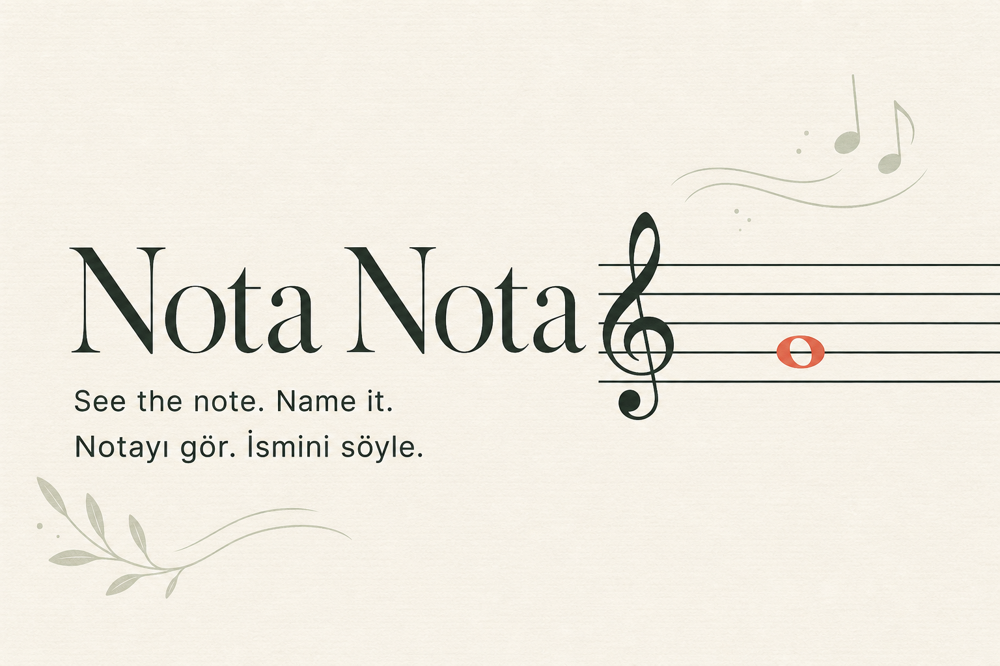

<div align="center">

# ♪ NotaNota

**Build fluent treble-clef note recognition through focused practice.**

[](#development-status)
[](https://react.dev/)
[](https://www.typescriptlang.org/)
[](#language-support)

[Live site](https://notanota.online) · [Features](#features) · [Practice modes](#practice-modes) · [Local development](#local-development)

</div>



## About

**NotaNota** is a bilingual, mobile-friendly trainer for learning natural notes on the treble clef. It combines focused practice, immediate feedback, session statistics, daily streaks, and optional community rankings.

## Development status

NotaNota is under active development. The static frontend is deployed from `main` through GitHub Pages and is available at [notanota.online](https://notanota.online).

Practice runs in the browser. Passwordless accounts, private streaks, and leaderboards use the configured Supabase project and transactional email provider.

## Features

- Four progressive treble-clef practice ranges
- An optional guitar-fretboard trainer grouped under Musical instruments
- Visual staff and written-position question modes
- Turkish solfege and English letter names
- Normal and endless practice modes
- Automatic repetition of incorrectly answered notes
- First-attempt accuracy and response-time statistics
- Responsive controls designed for desktop and mobile
- Passwordless email sign-in and a 3–7 character username
- Private, account-backed daily practice streaks with a Monday-to-Sunday activity view
- Separate, privacy-conscious leaderboards for each mode, range, and question style
- Turkish and English privacy information
- Original, low-volume piano ambience and a matching set of interface sounds

## Practice modes

### Normal

Every selected staff position appears once in the initial shuffled queue. A missed note returns later and remains in the session until answered correctly.

Only perfect sessions—with every note answered and no mistakes—qualify for the leaderboard. Qualifying sessions are ranked by fastest total completion time.

### Endless

Questions continue until the learner chooses to end the session or makes the first mistake. Only runs with no mistakes qualify for the leaderboard. Rankings prioritize the highest number of correct answers, with average response speed breaking ties.

## Practice ranges

| Level | Range | Notes |
|---|---|---:|
| **1** | Five staff lines and four spaces | 9 |
| **2** | Staff and nearby ledger lines | 13 |
| **3** | Every natural note from middle C to high C | 15 |
| **4** | Full staff with four ledger lines above and below | 25 |

## Musical instruments

The main learning focus remains fluent note reading. An optional guitar module extends that skill to the fretboard, with selectable 0–3, 0–5, and 0–12 fret ranges in standard tuning.

## Language support

| Interface | Note names |
|---|---|
| **Türkçe** | Do, Re, Mi, Fa, Sol, La, Si |
| **English** | C, D, E, F, G, A, B |

Language preference is stored locally in the browser.

## Local development

Requirements: Node.js 22.13 or newer and npm.

```bash
git clone https://github.com/alperferitko/note-reading-trainer.git
cd note-reading-trainer
npm ci
cp .env.example .env.local
npm run dev
```

Community features remain disabled when the Supabase variables are blank. See [Community setup](./docs/community-setup.md) for the private backend and email configuration checklist.

Useful commands:

```bash
npm run lint
npm test
npm run build
npm run build:pages
npm run test:pages
```

The only audio feedback is the pitch played after a correct answer. It is
generated in the browser with Web Audio, so no ambient music or interface
sound files are loaded.

## Architecture

The interface is built with React, TypeScript, Vinext, and Vite. Practice sessions run in the browser. Supabase provides passwordless authentication, profiles, private daily practice streaks, row-level security, and leaderboard score validation; email delivery is intended to use Resend through Supabase SMTP.

GitHub Pages hosts the static frontend. Supabase provides the external authenticated data layer, so no secrets or server runtime are bundled into the Pages output. Pushes to `main` run linting, tests, the static build, and deployment through GitHub Actions.

## Privacy and safety

Public leaderboard entries contain only a username and the qualifying score. Email addresses and daily practice dates stay private and are used only for authentication, account communication, and personal streak calculations.

Signed-in users can permanently delete their Supabase account and cascading profile, score, and practice-day records from the Account panel after typing an explicit confirmation phrase.

The in-app KVKK/privacy notice describes the current data flow and service providers. The cross-border transfer mechanism still requires final legal and operational review before it should be represented as complete.

## Contributing

Bug reports, accessibility improvements, translations, and focused feature proposals are welcome during development.

---

<div align="center">

**A little more fluent every day.**

</div>
