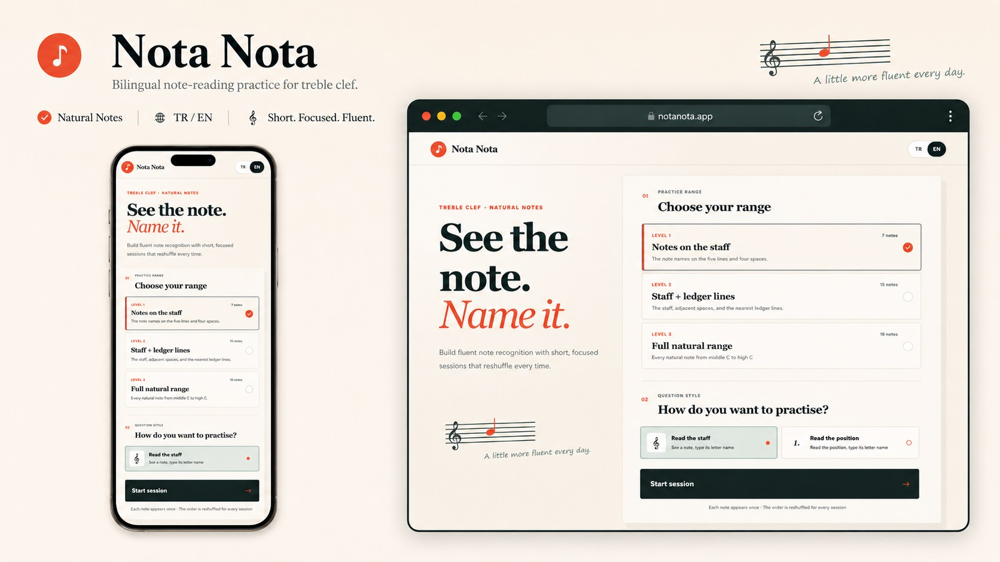

<div align="center">

# ♪ Nota Nota

**Build fluent treble-clef note recognition through focused practice.**

[](#development-status)
[](https://react.dev/)
[](https://www.typescriptlang.org/)
[](#language-support)

[Features](#features) · [Practice modes](#practice-modes) · [Local development](#local-development)

</div>



## About

**Nota Nota** is a bilingual, mobile-friendly trainer for learning natural notes on the treble clef. It combines focused practice, immediate feedback, session statistics, and optional community rankings.

## Development status

Nota Nota is currently in private development. The former GitHub Pages deployment and public demo are disabled while account, leaderboard, privacy, and production hosting work is completed.

The practice experience works locally. Community features require a configured Supabase project and transactional email provider before they can be enabled in production.

## Features

- Three progressive treble-clef practice ranges
- Visual staff and written-position question modes
- Turkish solfege and English letter names
- Normal and endless practice modes
- Automatic repetition of incorrectly answered notes
- First-attempt accuracy and response-time statistics
- Responsive controls designed for desktop and mobile
- Passwordless email sign-in and a 3–7 character username
- Separate, privacy-conscious leaderboards for each mode, range, and question style
- Turkish and English privacy information with a minimum user age of 13

## Practice modes

### Normal

Every selected staff position appears once in the initial shuffled queue. A missed note returns later and remains in the session until answered correctly.

Only perfect sessions—with every note answered and no mistakes—qualify for the leaderboard. Qualifying sessions are ranked by fastest total completion time.

### Endless

Questions continue until the learner chooses to end the session. Only mistake-free sessions qualify for the leaderboard. Rankings prioritize the highest number of correct answers, with average response speed breaking ties.

## Practice ranges

| Level | Range | Notes |
|---|---|---:|
| **1** | Five staff lines and four spaces | 9 |
| **2** | Staff and nearby ledger lines | 13 |
| **3** | Every natural note from middle C to high C | 15 |

## Language support

| Interface | Note names |
|---|---|
| **Türkçe** | Do, Re, Mi, Fa, Sol, La, Si |
| **English** | C, D, E, F, G, A, B |

Language preference is stored locally in the browser.

## Local development

Requirements: Node.js 22.13 or newer and npm.

```bash
git clone https://github.com/alperferitko/note-reading-trainer.git
cd note-reading-trainer
npm ci
cp .env.example .env.local
npm run dev
```

Community features remain disabled when the Supabase variables are blank. See [Community setup](./docs/community-setup.md) for the private backend and email configuration checklist.

Useful commands:

```bash
npm run lint
npm test
npm run build
```

## Architecture

The interface is built with React, TypeScript, Vinext, and Vite. Practice sessions run in the browser. Supabase provides passwordless authentication, profiles, row-level security, and leaderboard score validation; email delivery is intended to use Resend through Supabase SMTP.

The previous GitHub Pages workflow is intentionally disabled. GitHub Pages is not suitable for the complete community feature set on its own because it cannot provide the required authenticated data layer.

## Privacy and safety

Public leaderboard entries contain only a username and the qualifying score. Email addresses stay private and are used for authentication and account communication. The service is intended only for users aged 13 and older.

The in-app KVKK/privacy notice is a pre-release draft and must receive a final legal and operational review before public launch.

## Contributing

Bug reports, accessibility improvements, translations, and focused feature proposals are welcome during development.

---

<div align="center">

**A little more fluent every day.**

</div>
