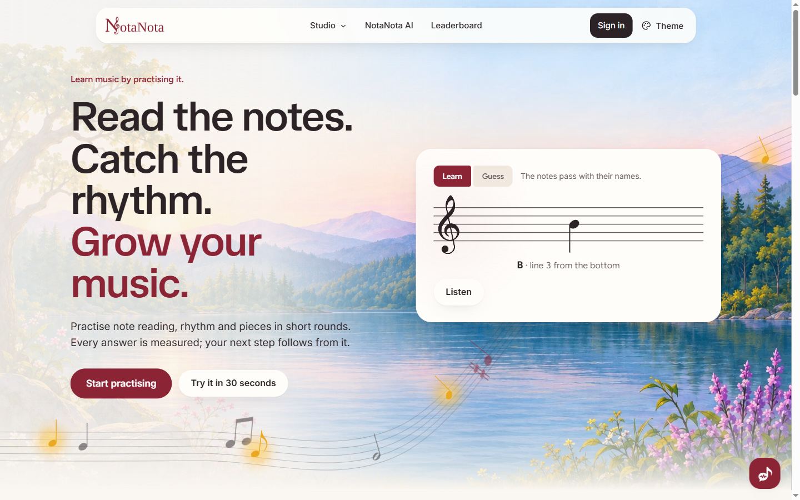
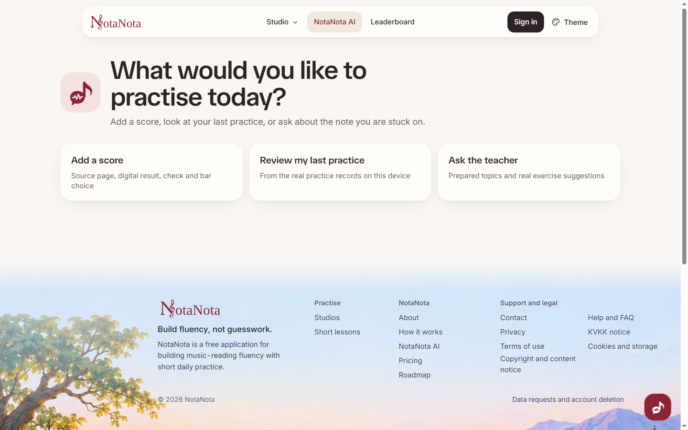

<div align="center">

# NotaNota AI

**Learn to read music by playing, with a Meta-powered teacher that works from your real answers.**

### [▶ Try the live app: notanota.online](https://notanota.online/en/)

<sub>For the easiest evaluation, use the live app. Running the repo locally does not enable the hosted AI backend.</sub>



</div>

AI can help us learn, but the joy of picking up an instrument and making music yourself is deeply human. NotaNota uses AI to make that path more accessible and to keep learners motivated.

## Try it in 4 steps

| | |
|---|---|
| **1. Sign in** | **Sign in** (top right), then the email link, then **Confirm my email**. Free 3-day AI trial. |
| **2. Practise** | **Studio → Note reading → Start session**, name the notes, then **Results →** |
| **3. AI feedback** | **Ask Meta AI** on the results card. It needs 3+ answers on a note, so play one more round if needed. |
| **4. Teacher chat** | **NotaNota AI → Ask the teacher**, or the chat button at the bottom right |

Trial limits per account: 25 AI requests a day and 60 in total. Practice itself is free and needs no account.

<div align="center"></div>

## How Meta is used

| Feature | Meta receives |
|---|---|
| 🎯 Practice feedback | A per-note summary of accuracy and speed |
| 💬 Teacher chat and weekly plan | Recent chat messages and your learning preferences |
| 📊 Weekly report | Only the numbers the app computed |
| 🎼 Score check | Thumbnails of the uploaded pages |

Pitch detection, scoring and statistics are plain code. Microphone audio never leaves the browser, and Meta never sees your email.

## Run locally

```bash
npm ci
cp .env.example .env.local   # optional: blank keeps accounts and AI off
npm run dev
```

**Tests:** `npm run lint && npm test && npm run test:ai && npm run test:upload`

## Stack

React 19 + Vite on GitHub Pages · Supabase (Auth, Postgres, Edge Function `ai-gateway`) · Meta Model API

**Limitations:**
- Recognising uploaded PDFs needs an OMR worker that is not running live. MusicXML files work.
- The microphone checks single notes only.

MIT licensed · [Third-party notices](./THIRD_PARTY_NOTICES.md)
